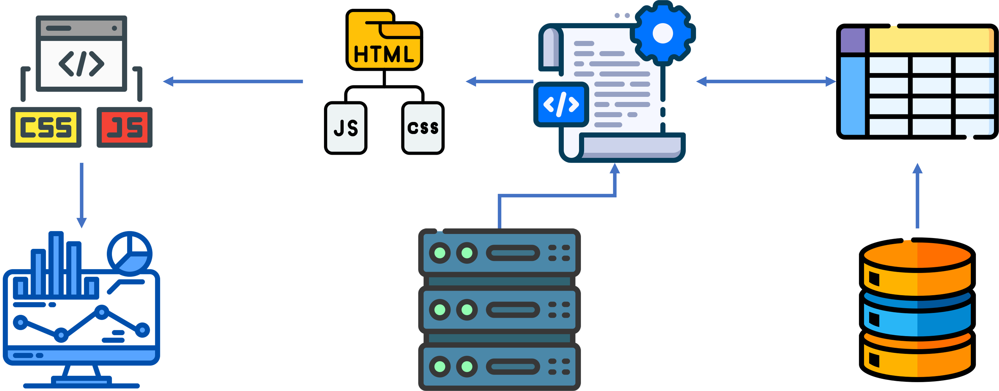
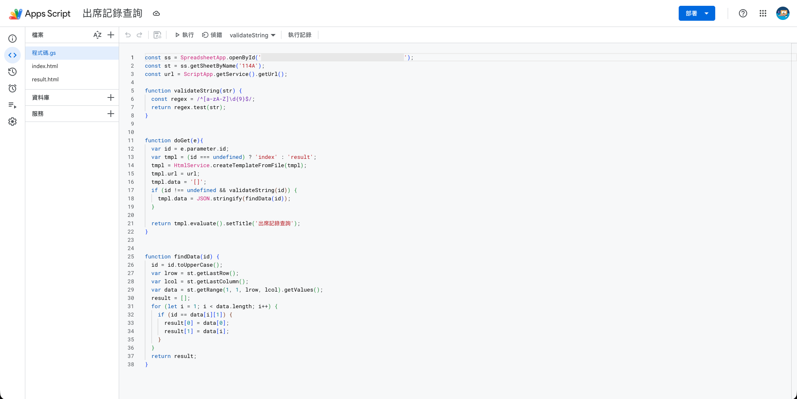
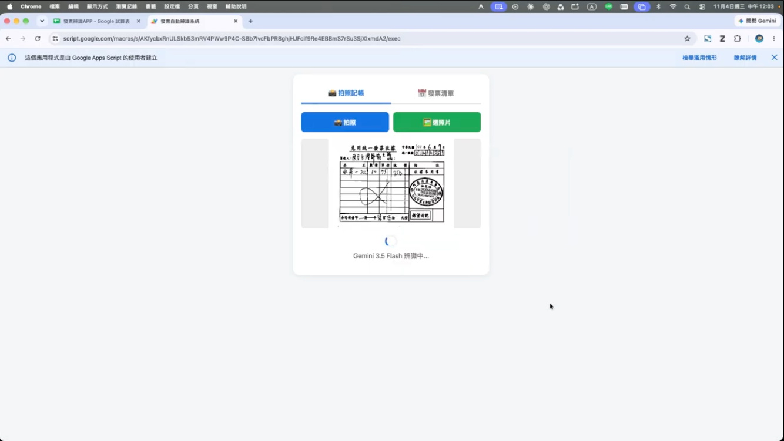

<!-- _class: cover -->

# 人工智慧應用開發實務
## Google Apps Script

<hr>

許智超
<cchsu@mail.nsysu.edu.tw>

---

<!-- _class: section-page -->

<span class="num">01</span>

## 認識 Google Apps Script

<hr>

---

<!-- _class: stats -->

### 什麼是 Google Apps Script (GAS)？

<hr>

<div class="stat-wrap">
<div class="stat">

#### 雲端自動化與擴充
<hr>

無需安裝軟體或伺服器，直接在雲端環境執行。

</div>
<div class="stat hi">

#### 整合 Google 生態系
<hr>

輕鬆連結並操控 Sheets, Docs, Gmail, Drive 與 Calendar。

</div>
<div class="stat">

#### 免維護基礎設施
<hr>

託管於 Google 雲端，具高可用度與免費使用額度。

</div>
</div>

---

<!-- _class: stats -->

### 為什麼要使用 GAS？

<hr>

<div class="stat-wrap">
<div class="stat">

#### 自動化重複工作
<hr>

定時寄送報表郵件、自動彙整表單回覆，大幅省時。

</div>
<div class="stat hi">

#### 串接跨服務流程
<hr>

表單提交自動建日曆行程、試算表更新自動發通知。

</div>
<div class="stat">

#### Web APP / API
<hr>

將試算表直接轉化為網頁應用程式或資料 API 介面。

</div>
</div>

---

<!-- _class: cols -->

### Google Apps Script 的專案類型

<hr>

<div class="col-wrap">
<div class="col">

#### 容器綁定專案

- **附屬關係**：依附於特定 Google 文件、試算表或表單中。
- **開啟方式**：選單點選「擴充功能」 $\rightarrow$ 「Apps Script」。
- **主要用途**：擴充該文件的專屬功能或建立自訂選單。

</div>
<div class="col alt">

#### 獨立專案

- **附屬關係**：獨立存在於 Google 雲端硬碟的檔案。
- **開啟方式**：Google Drive 點選「新增」 $\rightarrow$ 「更多」 $\rightarrow$ 「Google Apps Script」。
- **主要用途**：串接多項服務或作為獨立運行的 Web 服務。

</div>
</div>

---

<!-- _class: section-page -->

<span class="num">02</span>

## GAS 基本操作與部署

<hr>

---

### 基本操作流程 (1/2)：開啟與介面導覽

<hr>

1. **開啟開發者介面**
   - [Apps Script](https://script.google.com/)
   - 在 Google 雲端硬碟 $\rightarrow$ 選擇存放的資料夾後「新增」 $\rightarrow$ 「Google Apps Script」
   - 在 Google 試算表中，透過選單選取「擴充功能」 $\rightarrow$ 「Apps Script」。
2. **認識編輯器介面**
   - **左側檔案區**：管理腳本檔案與 HTML/CSS 檔。
   - **中央編輯區**：撰寫腳本邏輯與介面。
   - **上方工具列**：選擇要執行的函數、點選「執行」或「偵錯」。
   - **下方執行日誌**：檢視執行過程與紀錄輸出。

---

### 基本操作流程 (2/2)：執行與初次授權

<hr>

1. **選擇函數與執行**
   - 在工具列選擇目標函數，點選「執行」按鈕。
2. **授權驗證（第一次執行時）**
   - 因腳本需要存取你的 Google 服務（如 Gmail 或 Drive），系統會彈出權限請求。
   - 點選「審查權限」 $\rightarrow$ 選擇 Google 帳號 $\rightarrow$ 允許存取。
3. **查看執行結果**
   - 執行完成後可在「執行日誌」區塊確認結果或排錯。

---

### 觸發條件 (Triggers) 設定

<hr>

> **自動執行的核心機制**
> 無需人工手動點選「執行」，讓腳本在特定條件滿足時自動啟動。

- **時間驅動 (Time-driven)**
  - 定時執行，如：每天早上 8 點、每小時一次、每週一執行。
- **事件驅動 (Event-driven)**
  - 隨使用者動作啟動，如：開啟檔案時 (onOpen)、編輯試算表時 (onEdit)、提交 Google 表單時 (onFormSubmit)。


---

<style scoped>
.col-wrap .col li, .col p { font-size: 0.7em; }
</style>

<!-- _class: cols -->

### GAS01 每日行程彙整 Email

<hr>

<div class="col-wrap">
<div class="col">

#### 任務

**時間觸發器實作**

利用時間驅動觸發器，每天早上自動抓取當天的 Google 日曆行程，整理後寄到自己的 Gmail。

</div>
<div class="col alt">

#### 要求

- **讀取行程**：取得當天 Google 行事曆所有行程（標題、起訖時間、地點）。
- **整理內容**：依時間排序，組成易讀的信件內文；當天沒有行程時也要寄出提示。
- **寄送信件**：寄到自己的信箱，主旨包含日期。
- **設定觸發器**：建立「時間驅動 → 日計時器」，每天早上 7～8 點自動執行。

</div>
</div>

---

### 繳交方式

<hr>

> **錄影影片繳交**
> 錄製操作影片，上傳至雲端硬碟或 YouTube（不公開），繳交連結。

- **執行示範**：手動執行一次，並展示日曆行程與收到的 Email 內容相符。
- **觸發器設定**：展示「觸發條件」頁面的設定，以及執行紀錄。
- **注意事項**：錄影前確認連結權限可供檢視，並遮蔽個人隱私資訊。
- **螢幕錄影工具**：可用自己電腦的錄影工具或使用線上工具 [Stillroom](https://chihchao.github.io/screen-recorder/)

---

<style scoped>
.col-wrap .col li, .col p { font-size: 0.7em; }
</style>

<!-- _class: cols -->

### GAS02 表單自動收集與確認信

<hr>

<div class="col-wrap">
<div class="col">

#### 任務

**表單送出觸發器實作**
自訂一個報名或問卷主題（如活動報名、課程意見調查），以 Google 表單收集資料，送出後自動整理並寄確認信給填寫者。

</div>

<div class="col alt">

#### 要求

- **建立表單**：至少 5 個題目，須含姓名、Email 與一題選擇題，並連結回覆試算表。
- **表單送出觸發器**：建立「表單送出時」觸發器，由事件物件取得填寫內容。
- **確認信**：寄信給填寫者，主旨含表單名稱，內文列出填寫內容與送出時間。
- **額外資訊**：在確認信中加上一段因選擇題選擇結果不同給予不同的回覆。
- **回寫狀態**：在試算表新增「確認信狀態」欄，寄出後標記「已寄出」與寄信時間。

</div>
</div>

---

<style scoped>
.col-wrap .col li, .col p { font-size: 0.7em; }
</style>

<!-- _class: cols -->

### GAS03 學生成績自動處理

<hr>

<div class="col-wrap">
<div class="col">

#### 任務

**自訂選單一鍵處理**
建立「成績工具」自訂選單，一鍵完成成績計算、統計圖表繪製，並為每位學生輸出個人成績單 PDF。

**資料格式**：至少 60 位學生，含學號、姓名與 5 科以上成績，並另設「權重」列。

**測試資料**：[gas03.csv](assets/gas03.csv)
</div>

<div class="col alt">

#### 要求

- **自動計算**：建立自訂選單，一鍵算出加權總分、平均與排名。
- **等級評定**：依分數自動列出 A、B、C、D、F 等級（如 90↑ A、80 B、70 C、60 D、其餘 F）。
- **不及格標示**：任一科低於 60 分，該分數儲存格自動標紅色背景。
- **統計圖表**：建立各科平均長條圖與分數分布圖。
- **成績單 PDF**：依範本為每位學生產生 PDF（含各科分數與等級），存入雲端硬碟指定資料夾，檔名含學號與姓名。

</div>
</div>

---

<!-- _class: section-page -->

<span class="num">03</span>

## GAS Web APPs

<hr>

---

<style scoped>
section p { text-align: center; }
</style>

### 動態網頁架構

<hr><br>



---

<style scoped>
section p { text-align: center; }
</style>

### GAS 做為網路應用程式 (Web Apps)

<br>



---

### 部署為網絡應用程式

<hr>

> **將 GAS 變成線上網站或 API**

1. **點選部署**
   - 編輯器右上角點選「部署」 $\rightarrow$ 「新建部署」。
2. **設定類型與存取權限**
   - **類型**：選擇「網絡應用程式 (Web App)」。
   - **執行身分**：以「我」或存取使用者身分執行。
   - **存取權限**：設定「僅限自己」、「任何擁有 Google 帳戶的人」或「所有人 (含匿名)」。
3. **取得專屬 URL**
   - 完成後即可獲得一組網址，做為網頁入口或 API 端點。

---

### ❗部署之後又修改程式怎麼辦？

<hr>

> **儲存程式碼不會自動更新已部署的網址**
> 正式網址（`/exec`）固定指向某個「部署版本」，修改後必須重新部署才會生效。

1. **開發測試：使用「測試部署」**
   - 點選「部署」 $\rightarrow$ 「測試部署」，取得結尾為 `/dev` 的網址。
   - 此網址永遠執行最新儲存的程式碼，僅有編輯權限者可開啟，適合邊改邊測。
2. **正式更新：管理部署並建立新版本**
   - 點選「部署」 $\rightarrow$ 「管理部署作業」，按鉛筆圖示，版本選擇「新版本」後按「部署」。
   - **網址維持不變**，使用者不需更換連結。
3. **避免：重複「新建部署」**
   - 每次新建都會產生**新的網址**，舊網址仍執行舊版本，容易造成混亂。

---

<style scoped>
.col-wrap .col li, .col p { font-size: 0.6em; }
</style>

<!-- _class: cols -->

### GAS04 相簿 Web APP

<hr>

<div class="col-wrap">
<div class="col">

#### 任務

**公開相簿網站**
部署一個 Web App，讓任何人都能批次上傳照片，並以響應式網格瀏覽相簿、點擊查看大圖。照片存放於 Google Drive 指定資料夾。

**架構**：前端（HTML / JavaScript / CSS）負責選檔、縮圖與展示；後端（Apps Script）負責儲存與讀取，兩者以 `google.script.run` 溝通。

**範圍限制**：不做刪除／編輯、登入驗證，也不使用資料庫或試算表記錄。
</div>

<div class="col alt">

#### 要求

- **批次選檔**：支援單張與多張選取，限制 `image/*`；非圖檔須在前端即時攔截並警示。
- **前端縮圖**：以 `<canvas>` 等比壓縮，最長邊不超過 800px；原圖寬高皆小於 800px 時不放大。
- **佇列上傳**：轉為 Base64 後逐張依序上傳，不可併發，並顯示上傳進度。
- **後端儲存**：解析 Base64 建立 Blob，存入資料夾並設為「知道連結者可檢視」；資料夾 ID 由指令碼屬性 `FOLDER_ID` 讀取，未設定時回傳明確錯誤提示。
- **相簿展示**：讀取資料夾內所有圖檔（ID、檔名、建立時間、預覽連結），以網格呈現，點擊開啟大圖 Lightbox。
- **部署上線**：部署為 Web App 並提供可使用的網址。

</div>
</div>

---

<!-- _class: section-page -->

<span class="num">04</span>

## Gemini API

<hr>

---

### 為什麼連接大型語言模型？

<hr>


---

### 為什麼連接大型語言模型？

<hr>


---

### 為什麼連接大型語言模型？

<hr>


---

### 為什麼連接大型語言模型？

<hr>


---

### 連接大型語言模型可以做什麼？

<hr>


---

### 使用語言模型網站和連接語言模型會有什麼差別？

<hr>


---

### 如何連接大型語言模型？

<hr>


---
<style scoped>
.col-wrap .col li, .col p { font-size: 0.7em; }
</style>

<!-- _class: cols -->

### Gemini API 簡介

<hr>
<div class="col-wrap">
<div class="col">

#### Gemini API

Gemini API 是 Google 提供的一套雲端程式介面，讓開發者與企業能將 Gemini 系列大語言模型的能力，直接整合進自己的軟體、網站、App 或後台系統中。


</div>
<div class="col alt">

#### 核心能力與特性

- 多模態處理：能同時接收並理解文字、圖片、音訊、影片、PDF 文件以及程式碼。
- 超長上下文視窗：支援最高百萬級 Token 的上下文長度。
- 結構化輸出：支援強制回傳符合特定 Schema 的 JSON 格式。
- 函式呼叫（Function Calling）：讓模型能主動調用外部 API、資料庫或自定義工具。
- 嵌入向量：提供語意向量生成，用於建立語意搜尋、文件問答系統（RAG）或推薦引擎。
</div>
</div>

---

### 申請 Gemini API Key

<hr>

**準備事項**
使用個人 Google 帳號登入；API Key 是存取 Gemini 的密碼，不能公開貼在網站、GitHub 或投影片中。

- **進入 Google AI Studio**
  - 開啟 [https://aistudio.google.com/app/api-keys](https://aistudio.google.com/app/api-keys)，並以 Google 帳號登入。
- **建立 API Key**
  - 點選「Create API key」，選擇既有 Google Cloud 專案，或建立新專案。
- **在 GAS 中安全設定**
  - 開啟「專案設定」→「指令碼屬性」，新增 `GEMINI_API_KEY`；程式以 `PropertiesService` 讀取，不要把金鑰直接寫進程式碼。

---

<style scoped>
.col-wrap .col li, .col p { font-size: 0.6em; }
</style>

<!-- _class: cols -->

### GAS05 AI 自動分類客服訊息

<hr>

<div class="col-wrap">
<div class="col">

#### 任務

**AI 客服訊息自動分類**
建立「AI 客服」自訂選單，將所有客服訊息一次交給 Gemini API，由 AI 批次回傳每則的分類、緊急程度與回覆草稿。

**思考事項**：
1. 為什麼要批次而不要一則一則發送？
2. 資料一共有 200 筆。如果一次要求模型生成 200 筆的「類別、緊急程度、回覆草稿」，總長度會輕易超過單次 API 輸出的 Token 限制。怎麼辦？

**資料格式**：Google 試算表至少 200 則訊息，含編號、時間、客戶姓名、訊息內容；另設「處理結果」欄位。


**測試資料**：[gas05.csv](assets/gas05.csv)

</div>

<div class="col alt">

#### 要求

- **批次請求**：選單執行後，將所有「未處理」訊息（含編號）組成單一提示詞，只呼叫一次 API，不可逐則詢問。
- **分類欄位**：寫回類別（如 訂單查詢、退換貨、技術問題、客訴、其他）、緊急程度（高／中／低）與回覆草稿。
- **結構化輸出**：要求模型回傳 JSON 陣列，每筆含訊息編號，程式依編號對應填回各列；格式錯誤時顯示提示並中止。
- **金鑰安全**：API Key 存於指令碼屬性，不可寫在程式碼中。
- **視覺標示**：緊急程度「高」的整列自動標紅色背景。
- **統計摘要**：另建工作表，統計各類別訊息數量並繪製圓餅圖。

</div>
</div>


---

<style scoped>
p { text-align: center; }
</style>

### AI Chat 要素

<hr><br>


---

<style scoped>
.col-wrap .col li, .col p { font-size: 0.6em; }
</style>

<!-- _class: cols -->

### GAS06 AI Chatbot

<hr>

<div class="col-wrap">
<div class="col">

#### 任務

**可連網搜尋的 AI 聊天機器人**
以 GAS 網頁應用程式（Web App）建立簡易聊天網頁，使用者輸入問題後由 Gemini 回答；遇到時事、天氣、新聞等最新資訊時，能自動連網搜尋並附上資料來源。

</div>

<div class="col alt">

#### 要求

- **聊天介面**：建立簡易聊天網頁，含訊息顯示區、輸入框與送出按鈕，並區分使用者與機器人的訊息樣式。
- **對話記憶**：保留前幾輪對話內容，讓機器人能理解上下文。
- **安全與錯誤處理**：API Key 存於指令碼屬性；呼叫失敗時顯示友善提示，不可讓頁面當掉。
- **部署上線**：部署為 Web App 並提供可使用的網址。

</div>
</div>

---

### Gemini File Search

<hr>

> **受管理的 RAG（檢索增強生成）工具**
> 讓 Gemini 先從自有文件找出相關內容，再依據內容回答；適合課程講義、規章、產品文件與內部知識庫。

1. **建立 File Search Store**
  - 建立專屬的文件儲存庫，作為可被語意搜尋的知識庫。
2. **上傳並建立索引**
  - 將 PDF、Word、試算表、文字或程式碼等檔案匯入；系統會自動分塊、產生嵌入向量並建立索引。
3. **提問時啟用 `file_search` 工具**
  - Gemini 將問題轉成嵌入向量，找出語意最相關的文件片段，再據以生成回答。
4. **取得可追溯的回答**
  - 回應可附帶 `file_citation` 引文；PDF 還可取得引用頁碼，方便核對來源。

**注意**：原始 `File` 物件會在 48 小時後刪除，但已匯入儲存庫的索引資料會保留至手動刪除；單一文件上限為 100 MB，目前不支援音訊與影片。

---

<style scoped>
.col-wrap .col li, .col p { font-size: 0.6em; }
</style>

<!-- _class: cols -->

### GAS07 File Search Manager

<hr>

<div class="col-wrap">
<div class="col">

#### 任務

**Gemini File Search 知識庫管理工具**
以 GAS 網頁應用程式（Web App）建立管理介面，能管理自己的 File Search 檔案知識庫，包含上傳檔案建立知識庫、修改知識庫、刪除知識庫，並可直接提問測試知識庫內容。

**測試資料**：準備至少 3 份自選文件（如課程講義、規章、產品說明 PDF）建立知識庫。

- [iPAS AI 應用規劃師 - 學習資源](https://ipd.nat.gov.tw/ipas/certification/AIAP/learning-resources)

</div>

<div class="col alt">

#### 要求

- **知識庫清單**：列出帳號下所有 File Search Store 的名稱與建立時間。
- **建立知識庫**：輸入顯示名稱後建立新的 Store。
- **上傳檔案**：可從網頁選擇檔案（或指定雲端硬碟檔案），上傳並匯入指定 Store，完成前顯示處理狀態。
- **修改知識庫**：列出 Store 內的文件，可刪除單一文件，或以新版檔案取代舊檔（刪除後重新上傳）。
- **刪除知識庫**：刪除整個 Store，需先跳出確認視窗，避免誤刪。
- **提問測試**：選定 Store 後提問，啟用 `file_search` 工具回答，並顯示引用的文件來源。
- **安全與錯誤處理**：API Key 存於指令碼屬性；不支援的格式、檔案過大或呼叫失敗時顯示友善提示。

</div>
</div>

---

<style scoped>
.col-wrap .col li, .col p { font-size: 0.6em; }
</style>

<!-- _class: cols -->

### GAS08 知識庫問答 Chatbot

<hr>

<div class="col-wrap">
<div class="col">

#### 任務

**讓 GAS06 chatbot 使用 GAS07 的知識庫**
改良 GAS06 的 AI Chatbot，串接 GAS07 建立的 File Search 知識庫，讓機器人能依據自有文件回答問題，並標示答案出自哪份文件；當知識庫查不到時，再視情況連網搜尋。

**測試資料**：沿用 GAS07 的文件與知識庫，另設計至少 5 個問題：3 個能在文件中找到答案、1 個文件中沒有、1 個需最新資訊。
</div>

<div class="col alt">

#### 要求

- **指定知識庫**：Store 名稱存於指令碼屬性，不可寫死在程式碼中。
- **文件引用**：回答下方列出引用的文件名稱與片段，取自回應的 `groundingMetadata`。
- **範圍控制**：以系統提示詞要求優先依據知識庫回答；文件查無相關內容時，需明確告知，不可憑空編造。
- **連網補充**：知識庫查無答案時才連網搜尋，並在回答中標示資訊來源為「知識庫」或「網路」。
- **對話記憶與錯誤處理**：保留前幾輪對話；Store 不存在或呼叫失敗時顯示友善提示。
- **測試紀錄**：提交 5 個測試問題的截圖，並說明各自引用的來源。

</div>
</div>

---

<!-- _class: section-page -->

<span class="num">05</span>

## 認識資料庫

<hr>

---

<!-- _class: stats -->

### 什麼是資料庫？

<hr>
資料庫是一個有組織、可長期保存的資料集合，讓程式能有系統地儲存、查詢與管理資料。

<div class="stat-wrap">
<div class="stat">

#### 結構化儲存
<hr>

以固定的欄位格式儲存大量資料，避免雜亂無章。

</div>
<div class="stat hi">

#### 方便查詢與管理
<hr>

可依條件搜尋、排序、篩選，快速取得所需資料。

</div>
<div class="stat">

#### 支援程式化存取
<hr>

程式可自動讀寫資料，實現自動化與跨系統整合。

</div>
</div>

---

<!-- _class: cols -->

### 為什麼需要資料庫？

<hr>

<div class="col-wrap">
<div class="col">

#### 沒有資料庫

- **資料會消失**：變數與頁面狀態在程式結束或重新整理後就不見了。
- **難以累積**：聊天紀錄、訂單與成績無法長期保存，也無法回頭查詢。
- **無法共用**：每位使用者各自一份，彼此看不到對方的資料。
- **容易混亂**：資料散落在多個檔案，格式不一、重複又難以更新。

</div>
<div class="col alt">

#### 有了資料庫

- **持久保存**：資料寫入後長期保留，下次執行仍可讀取。
- **集中管理**：多位使用者與多個程式共用同一份資料，確保一致。
- **快速查詢**：依條件搜尋、排序、統計，不必逐筆人工翻找。
- **支援應用**：為會員系統、聊天紀錄、訂單、報表等應用提供資料基礎。

</div>
</div>

---

<!-- _class: quad -->

### CRUD：資料庫的四大基本操作

<hr>

<div class="quad-wrap">
<div class="item">

#### Create 新增

寫入一筆新的記錄

</div>
<div class="item">

#### Read 讀取

查詢並取出既有的資料

</div>
<div class="item">

#### Update 更新

修改既有記錄的內容

</div>
<div class="item">

#### Delete 刪除

移除不再需要的記錄

</div>
</div>

---

<!-- _class: quad -->

### 資料庫的基本結構

<hr>

<div class="quad-wrap">
<div class="item">

#### 資料表 Table

儲存同一類資料的集合

</div>
<div class="item">

#### 記錄 Record

資料表中的一列，代表一筆資料

</div>
<div class="item">

#### 欄位 Field

資料表中的一欄，代表一種屬性

</div>
<div class="item">

#### 主鍵 Primary Key

用來唯一識別每一筆記錄的欄位

</div>
</div>

---

### GAS 把試算表當資料庫

<hr>

**概念對應**：試算表的工作表就像資料表，一列就像一筆記錄，一欄就像一個欄位。我們可以使用 GAS 存取試算表資料

| 資料庫概念 | 試算表對應 |
| --- | --- |
| 資料表 (Table) | 工作表 (Sheet) |
| 記錄 (Record) | 一列資料 (Row) |
| 欄位 (Field) | 一欄資料 (Column) |
| 綱要 (Schema) | 標題列 (Header Row) |
| 主鍵 (Primary Key) | 具唯一值的欄位，如「編號」欄 |

---

<style scoped>
.col-wrap .col li, .col p { font-size: 0.6em; }
</style>

<!-- _class: cols -->

### GAS09 發票自動 OCR APP

<hr>


[發票自動 OCR APP 任務說明](https://drive.google.com/file/d/1dvsbYETg_Q9mjV46yoRtzBYQkfnBXDAd/view)

---

<style scoped>
.col-wrap .col li, .col p { font-size: 0.7em; }
</style>

<!-- _class: cols -->

### 關聯式資料庫與正規化

<hr>

<div class="col-wrap">
<div class="col">

#### 關聯式資料庫 (RDB)

將資料分門別類存放在多張資料表中，再以**主鍵與外鍵**建立表與表之間的關聯。

- **資料表**：每張表只描述一種主題，如學生、活動。
- **關聯**：以外鍵指向另一張表的主鍵，需要時再串接查詢。
- **常見系統**：MySQL、PostgreSQL、SQL Server，查詢語言為 SQL。

</div>
<div class="col alt">

#### 正規化 (Normalization)

將資料拆分、整理成多張結構良好的資料表，減少重複並避免異常。

- **每格一值**：每個欄位只存放單一、不可再分的值。
- **依賴主鍵**：非主鍵欄位要完整描述該筆記錄的主鍵。
- **各表一題**：資料不重複存放，一項事實只記錄在一個地方。
- **目的**：節省空間、維持一致、避免更新、新增與刪除異常。

</div>
</div>

---

<style scoped>
table { font-size: 0.5em; }
</style>

### 範例：校園社團活動報名系統

<hr>

**痛點情境**：把所有資訊塞進同一張「活動報名清單」大表格。

| 報名編號 | 學號 | 姓名 | 系所 | 手機 | 活動名稱 | 活動地點 | 活動日期 | 費用 | 主辦幹部 | 幹部電話 |
| --- | --- | --- | --- | --- | --- | --- | --- | --- | --- | --- |
| R001 | B11201 | 王小明 | 資工系 | 0912-345-678 | 程式設計營 | 資電館 | 11/05 | 100 | 陳大華 | 0922-111-222 |
| R002 | B11201 | 王小明 | 資工系 | 0912-345-678 | 迎新露營 | 烏來 | 11/18 | 800 | 李佳玲 | 0933-222-333 |
| R003 | B11201 | 王小明 | 資工系 | 0912-345-678 | 社團成果展 | 學生活動中心 | 12/02 | 0 | 林志偉 | 0955-444-555 |
| R004 | B11305 | 陳怡君 | 企管系 | 0987-654-321 | 程式設計營 | 資電館 | 11/05 | 100 | 陳大華 | 0922-111-222 |

同一位學生、同一個活動的資料不斷**重複出現**。

---

<!-- _class: stats -->

### 大表格的三種異常

<hr>

<div class="stat-wrap">
<div class="stat">

#### 更新異常
<hr>

學生報名 3 個活動，手機號碼改了要改幾次？漏改一筆，資料就前後不一致。

</div>
<div class="stat hi">

#### 新增異常
<hr>

新活動還沒人報名時，系統裡看得到這個活動的資訊嗎？沒有報名記錄就無處可存。

</div>
<div class="stat">

#### 刪除異常
<hr>

活動唯一的報名記錄被刪除時，活動名稱、地點與費用也跟著消失。

</div>
</div>

---

<style scoped>
.stat li, .stat p { font-size: 0.75em; text-align: left; }
</style>

<!-- _class: stats -->

### 正規化：拆成 3 張資料表

<hr>

<div class="stat-wrap">
<div class="stat">

#### 學生表
<hr>
Students

- 學號（**PK**）
- 姓名
- 系所
- 手機

</div>
<div class="stat">

#### 活動表
<hr>
Events

- 活動 ID（**PK**）
- 活動名稱
- 地點、日期、費用
- 主辦幹部

</div>
<div class="stat">

#### 報名關聯表
<hr>
Registrations

- 報名 ID（**PK**）
- 學號（**FK**）
- 活動 ID（**FK**）
- 報名時間、繳費狀態

</div>
</div>

---

<style scoped>
.col-wrap .col li, .col p { font-size: 0.7em; }
</style>

<!-- _class: cols -->

### 資料表如何連結？

<hr>

<div class="col-wrap">
<div class="col">

#### 主鍵與外鍵

- **主鍵 PK**：唯一識別一筆記錄，如學號、活動 ID、報名 ID。
- **外鍵 FK**：存放另一張表的主鍵，用來指向對應的記錄。
- **關聯表**：報名表只記錄「誰（學號）報名了哪個活動（活動 ID）」，需要詳細資料時再依鍵值回頭查詢。

</div>
<div class="col alt">

#### 異常如何解決

- **更新**：手機只存在學生表一處，改一次即可。
- **新增**：活動資料存於活動表，沒人報名也能先建立。
- **刪除**：刪除報名記錄不會影響學生與活動資料。
- **重複**：同一筆資料只存一次，節省空間且保持一致。

</div>
</div>

---

### 試算表實作 (1/3)：用 XLOOKUP 實現關聯

<hr>

在「報名表」輸入學號與活動 ID，自動帶出姓名與活動名稱，等同 SQL 的 **JOIN**。

| 報名表欄位 | A | B | C | D | E | F | G | H | I |
| --- | --- | --- | --- | --- | --- | --- | --- | --- | --- |
| 內容 | 報名 ID | 學號 (FK) | 活動 ID (FK) | 報名時間 | 繳費狀態 | 姓名 | 活動名稱 | 系所 | 費用 |

```
F2：=XLOOKUP(B2, Students!A:A, Students!B:B, "查無此學號")
G2：=XLOOKUP(C2, Events!A:A, Events!B:B, "查無此活動")
```

- **舊版寫法**：`=VLOOKUP(B2, Students!A:B, 2, FALSE)`，查詢鍵必須位於範圍最左欄。
- **效果**：學生手機或系所只維護在學生表，報名表自動同步。

---

<style scoped>
.col-wrap .col li, .col p { font-size: 0.7em; }
</style>

<!-- _class: cols -->

### 試算表實作 (2/3)：多對多關係與中繼表

<hr>

<div class="col-wrap">
<div class="col">

#### 為什麼需要中繼表？

- **學生 → 活動**：一位學生可報名多個活動。
- **活動 → 學生**：一個活動可有多位學生報名。
- **無法直接存放**：把學生欄位放進活動表，或把活動欄位放進學生表，都會出現重複或欄位不夠用。

</div>
<div class="col alt">

#### 解法：報名關聯表

- 將「多對多」拆成兩個「一對多」：學生表 → 報名表、活動表 → 報名表。
- 每筆報名記錄一組（學號、活動 ID）。
- 報名時間、繳費狀態屬於「這位學生報名這個活動」，也只能存放在中繼表。

</div>
</div>

---

<style scoped>
.col-wrap .col li, .col p { font-size: 0.6em; }
</style>

<!-- _class: cols -->

### GAS10 外送平台點餐訂單資料庫

<hr>

以 Google 試算表設計外送點餐資料庫，練習將一張大表拆解成適合的架構。

測試資料：[gas10.csv](assets/gas10.csv)
