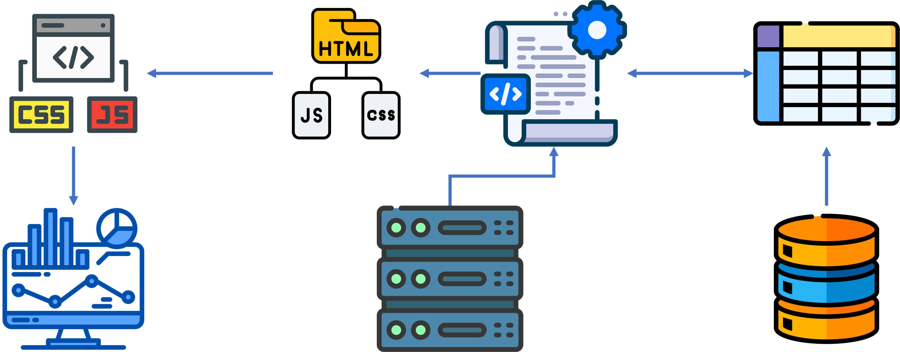
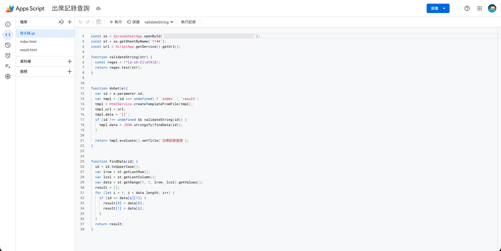

<!-- _class: cover -->

# 人工智慧應用開發實務
## Google Apps Script

許智超
<cchsu@mail.nsysu.edu.tw>

---

<!-- _class: section-page -->

01

## 認識 Google Apps Script

---

<!-- _class: stats -->

### 什麼是 Google Apps Script (GAS)？

#### 雲端自動化與擴充

無需安裝軟體或伺服器，直接在雲端環境執行。

#### 整合 Google 生態系

輕鬆連結並操控 Sheets, Docs, Gmail, Drive 與 Calendar。

#### 免維護基礎設施

託管於 Google 雲端，具高可用度與免費使用額度。

---

<!-- _class: stats -->

### 為什麼要使用 GAS？

#### 自動化重複工作

定時寄送報表郵件、自動彙整表單回覆，大幅省時。

#### 串接跨服務流程

表單提交自動建日曆行程、試算表更新自動發通知。

#### Web APP / API

將試算表直接轉化為網頁應用程式或資料 API 介面。

---

<!-- _class: cols -->

### Google Apps Script 的專案類型

#### 容器綁定專案

- **附屬關係**：依附於特定 Google 文件、試算表或表單中。
- **開啟方式**：選單點選「擴充功能」 $\rightarrow$ 「Apps Script」。
- **主要用途**：擴充該文件的專屬功能或建立自訂選單。

#### 獨立專案

- **附屬關係**：獨立存在於 Google 雲端硬碟的檔案。
- **開啟方式**：Google Drive 點選「新增」 $\rightarrow$ 「更多」 $\rightarrow$ 「Google Apps Script」。
- **主要用途**：串接多項服務或作為獨立運行的 Web 服務。

---

<!-- _class: section-page -->

02

## GAS 基本操作與部署

---

### 基本操作流程 (1/2)：開啟與介面導覽

1. **開啟開發者介面**
   - [Apps Script](https://script.google.com/)
   - 在 Google 雲端硬碟 $\rightarrow$ 選擇存放的資料夾後「新增」 $\rightarrow$ 「Google Apps Script」
   - 在 Google 試算表中，透過選單選取「擴充功能」 $\rightarrow$ 「Apps Script」。
2. **認識編輯器介面**
   - **左側檔案區**：管理腳本檔案與 HTML/CSS 檔。
   - **中央編輯區**：撰寫腳本邏輯與介面。
   - **上方工具列**：選擇要執行的函數、點選「執行」或「偵錯」。
   - **下方執行日誌**：檢視執行過程與紀錄輸出。

---

### 基本操作流程 (2/2)：執行與初次授權

1. **選擇函數與執行**
   - 在工具列選擇目標函數，點選「執行」按鈕。
2. **授權驗證（第一次執行時）**
   - 因腳本需要存取你的 Google 服務（如 Gmail 或 Drive），系統會彈出權限請求。
   - 點選「審查權限」 $\rightarrow$ 選擇 Google 帳號 $\rightarrow$ 允許存取。
3. **查看執行結果**
   - 執行完成後可在「執行日誌」區塊確認結果或排錯。

---

### 觸發條件 (Triggers) 設定

> **自動執行的核心機制**
> 無需人工手動點選「執行」，讓腳本在特定條件滿足時自動啟動。

- **時間驅動 (Time-driven)**
  - 定時執行，如：每天早上 8 點、每小時一次、每週一執行。
- **事件驅動 (Event-driven)**
  - 隨使用者動作啟動，如：開啟檔案時 (onOpen)、編輯試算表時 (onEdit)、提交 Google 表單時 (onFormSubmit)。

---

<!-- _class: cols -->

### GAS01 每日行程彙整 Email

#### 任務

**時間觸發器實作**

利用時間驅動觸發器，每天早上自動抓取當天的 Google 日曆行程，整理後寄到自己的 Gmail。

#### 要求

- **讀取行程**：取得當天 Google 行事曆所有行程（標題、起訖時間、地點）。
- **整理內容**：依時間排序，組成易讀的信件內文；當天沒有行程時也要寄出提示。
- **寄送信件**：寄到自己的信箱，主旨包含日期。
- **設定觸發器**：建立「時間驅動 → 日計時器」，每天早上 7～8 點自動執行。

---

### 繳交方式

> **錄影影片繳交**
> 錄製操作影片，上傳至雲端硬碟或 YouTube（不公開），繳交連結。

- **執行示範**：手動執行一次，並展示日曆行程與收到的 Email 內容相符。
- **觸發器設定**：展示「觸發條件」頁面的設定，以及執行紀錄。
- **注意事項**：錄影前確認連結權限可供檢視，並遮蔽個人隱私資訊。
- **螢幕錄影工具**：可用自己電腦的錄影工具或使用線上工具 [Stillroom](https://chihchao.github.io/screen-recorder/)

---

<!-- _class: cols -->

### GAS02 表單自動收集與確認信

#### 任務

**表單送出觸發器實作**
自訂一個報名或問卷主題（如活動報名、課程意見調查），以 Google 表單收集資料，送出後自動整理並寄確認信給填寫者。

#### 要求

- **建立表單**：至少 5 個題目，須含姓名、Email 與一題選擇題，並連結回覆試算表。
- **表單送出觸發器**：建立「表單送出時」觸發器，由事件物件取得填寫內容。
- **確認信**：寄信給填寫者，主旨含表單名稱，內文列出填寫內容與送出時間。
- **回寫狀態**：在試算表新增「確認信狀態」欄，寄出後標記「已寄出」與寄信時間。
- **資料檢核**：Email 格式不正確或必填欄位空白時，不寄信並標記「資料有誤」。

---

<!-- _class: cols -->

### GAS03 學生成績自動處理

#### 任務

**自訂選單一鍵處理**
建立「成績工具」自訂選單，一鍵完成成績計算、統計圖表繪製，並為每位學生輸出個人成績單 PDF。

**資料格式**：至少 60 位學生，含學號、姓名與 5 科以上成績，並另設「權重」列。

#### 要求

- **自動計算**：建立自訂選單，一鍵算出加權總分、平均與排名。
- **等級評定**：依分數自動列出 A、B、C、D、F 等級（如 90↑ A、80 B、70 C、60 D、其餘 F）。
- **不及格標示**：任一科低於 60 分，該分數儲存格自動標紅色背景。
- **統計圖表**：建立各科平均長條圖與分數分布圖。
- **成績單 PDF**：依範本為每位學生產生 PDF（含各科分數與等級），存入雲端硬碟指定資料夾，檔名含學號與姓名。

---

<!-- _class: section-page -->

03

## Gemini API

---

<!-- _class: cols -->

### Gemini API 簡介

#### Gemini API

Gemini API 是 Google 提供的一套雲端程式介面，讓開發者與企業能將 Gemini 系列大語言模型的能力，直接整合進自己的軟體、網站、App 或後台系統中。

#### 核心能力與特性

- 多模態處理：能同時接收並理解文字、圖片、音訊、影片、PDF 文件以及程式碼。
- 超長上下文視窗：支援最高百萬級 Token 的上下文長度。
- 結構化輸出：支援強制回傳符合特定 Schema 的 JSON 格式。
- 函式呼叫（Function Calling）：讓模型能主動調用外部 API、資料庫或自定義工具。
- 嵌入向量：提供語意向量生成，用於建立語意搜尋、文件問答系統（RAG）或推薦引擎。

---

### 申請 Gemini API Key

**準備事項**
使用個人 Google 帳號登入；API Key 是存取 Gemini 的密碼，不能公開貼在網站、GitHub 或投影片中。

- **進入 Google AI Studio**
  - 開啟 [https://aistudio.google.com/app/api-keys](https://aistudio.google.com/app/api-keys)，並以 Google 帳號登入。
- **建立 API Key**
  - 點選「Create API key」，選擇既有 Google Cloud 專案，或建立新專案。
- **在 GAS 中安全設定**
  - 開啟「專案設定」→「指令碼屬性」，新增 `GEMINI_API_KEY`；程式以 `PropertiesService` 讀取，不要把金鑰直接寫進程式碼。

---

<!-- _class: cols -->

### GAS04 AI 自動分類客服訊息

#### 任務

**AI 客服訊息自動分類**
建立「AI 客服」自訂選單，將所有客服訊息一次交給 Gemini API，由 AI 批次回傳每則的分類、緊急程度與回覆草稿。

**資料格式**：Google 試算表至少 200 則訊息，含編號、時間、客戶姓名、訊息內容；另設「處理結果」欄位。

#### 要求

- **批次請求**：選單執行後，將所有「未處理」訊息（含編號）組成單一提示詞，只呼叫一次 API，不可逐則詢問。
- **分類欄位**：寫回類別（如 訂單查詢、退換貨、技術問題、客訴、其他）、緊急程度（高／中／低）與回覆草稿。
- **結構化輸出**：要求模型回傳 JSON 陣列，每筆含訊息編號，程式依編號對應填回各列；格式錯誤時顯示提示並中止。
- **金鑰安全**：API Key 存於指令碼屬性，不可寫在程式碼中。
- **視覺標示**：緊急程度「高」的整列自動標紅色背景。
- **統計摘要**：另建工作表，統計各類別訊息數量並繪製圓餅圖。

---

<!-- _class: section-page -->

04

## GAS Web APPs

---

### 動態網頁架構

 

---

### GAS 做為網路應用程式 (Web Apps)

 

---

### 部署為網絡應用程式

> **將 GAS 變成線上網站或 API**

1. **點選部署**
   - 編輯器右上角點選「部署」 $\rightarrow$ 「新建部署」。
2. **設定類型與存取權限**
   - **類型**：選擇「網絡應用程式 (Web App)」。
   - **執行身分**：以「我」或存取使用者身分執行。
   - **存取權限**：設定「僅限自己」、「任何擁有 Google 帳戶的人」或「所有人 (含匿名)」。
3. **取得專屬 URL**
   - 完成後即可獲得一組網址，做為網頁入口或 API 端點。

---

### ❗部署之後又修改程式怎麼辦？

> **儲存程式碼不會自動更新已部署的網址**
> 正式網址（`/exec`）固定指向某個「部署版本」，修改後必須重新部署才會生效。

1. **開發測試：使用「測試部署」**
   - 點選「部署」 $\rightarrow$ 「測試部署」，取得結尾為 `/dev` 的網址。
   - 此網址永遠執行最新儲存的程式碼，僅有編輯權限者可開啟，適合邊改邊測。
2. **正式更新：管理部署並建立新版本**
   - 點選「部署」 $\rightarrow$ 「管理部署作業」，按鉛筆圖示，版本選擇「新版本」後按「部署」。
   - **網址維持不變**，使用者不需更換連結。
3. **避免：重複「新建部署」**
   - 每次新建都會產生**新的網址**，舊網址仍執行舊版本，容易造成混亂。

---

<!-- _class: cols -->

### GAS05 相簿 Web APP

#### 任務

**公開相簿網站**
部署一個 Web App，讓任何人都能批次上傳照片，並以響應式網格瀏覽相簿、點擊查看大圖。照片存放於 Google Drive 指定資料夾。

**架構**：前端（HTML / JavaScript / CSS）負責選檔、縮圖與展示；後端（Apps Script）負責儲存與讀取，兩者以 `google.script.run` 溝通。

#### 要求

- **批次選檔**：支援單張與多張選取，限制 `image/*`；非圖檔須在前端即時攔截並警示。
- **前端縮圖**：以 `<canvas>` 等比壓縮，最長邊不超過 800px；原圖寬高皆小於 800px 時不放大。
- **佇列上傳**：轉為 Base64 後逐張依序上傳，不可併發，並顯示上傳進度。
- **後端儲存**：解析 Base64 建立 Blob，存入資料夾並設為「知道連結者可檢視」；資料夾 ID 由指令碼屬性 `FOLDER_ID` 讀取，未設定時回傳明確錯誤提示。
- **相簿展示**：讀取資料夾內所有圖檔（ID、檔名、建立時間、預覽連結），以網格呈現，點擊開啟大圖 Lightbox。
- **部署設定**：執行身分「我」、存取權限「所有人（含匿名）」。
- **範圍限制**：不做刪除／編輯、登入驗證，也不使用資料庫或試算表記錄。

---

### AI Chat 要素

 

---

<!-- _class: cols -->

### GAS06 AI Chatbot

#### 任務

**可連網搜尋的 AI 聊天機器人**
以 GAS 網頁應用程式（Web App）建立簡易聊天網頁，使用者輸入問題後由 Gemini 回答；遇到時事、天氣、新聞等最新資訊時，能自動連網搜尋並附上資料來源。

**主題自訂**：自選一個情境，如校園問答、旅遊小幫手、新聞摘要助理，並以系統提示詞設定機器人的角色與語氣。

**範例測試**：至少測試 3 個需要最新資訊的問題，並截圖留存。

#### 要求

- **聊天介面**：以 `doGet()` 搭配 HtmlService 建立網頁，含訊息顯示區、輸入框與送出按鈕，並區分使用者與機器人的訊息樣式。
- **連網搜尋**：呼叫 Gemini API 時啟用 Google Search 工具（grounding），讓模型自行判斷是否需要搜尋。
- **資料來源**：回答下方列出參考網頁的標題與連結。
- **對話記憶**：保留前幾輪對話內容，讓機器人能理解上下文（如「那明天呢？」）。
- **系統提示詞**：設定角色、回答語言與範圍，超出範圍時禮貌拒答。
- **安全與錯誤處理**：API Key 存於指令碼屬性；呼叫失敗時顯示友善提示，不可讓頁面當掉。
- **部署上線**：部署為 Web App 並提供可使用的網址。

---

### Gemini File Search

> **受管理的 RAG（檢索增強生成）工具**
> 讓 Gemini 先從自有文件找出相關內容，再依據內容回答；適合課程講義、規章、產品文件與內部知識庫。

1. **建立 File Search Store**
  - 建立專屬的文件儲存庫，作為可被語意搜尋的知識庫。
2. **上傳並建立索引**
  - 將 PDF、Word、試算表、文字或程式碼等檔案匯入；系統會自動分塊、產生嵌入向量並建立索引。
3. **提問時啟用 `file_search` 工具**
  - Gemini 將問題轉成嵌入向量，找出語意最相關的文件片段，再據以生成回答。
4. **取得可追溯的回答**
  - 回應可附帶 `file_citation` 引文；PDF 還可取得引用頁碼，方便核對來源。

**注意**：原始 `File` 物件會在 48 小時後刪除，但已匯入儲存庫的索引資料會保留至手動刪除；單一文件上限為 100 MB，目前不支援音訊與影片。

---

<!-- _class: cols -->

### GAS07 File Search Manager

#### 任務

**Gemini File Search 知識庫管理工具**
以 GAS 網頁應用程式（Web App）建立管理介面，能管理自己的 File Search 檔案知識庫，包含上傳檔案建立知識庫、修改知識庫、刪除知識庫，並可直接提問測試知識庫內容。

**測試資料**：準備至少 3 份自選文件（如課程講義、規章、產品說明 PDF），建立兩個以上知識庫。

#### 要求

- **知識庫清單**：列出帳號下所有 File Search Store 的名稱與建立時間。
- **建立知識庫**：輸入顯示名稱後建立新的 Store。
- **上傳檔案**：可從網頁選擇檔案（或指定雲端硬碟檔案），上傳並匯入指定 Store，完成前顯示處理狀態。
- **修改知識庫**：列出 Store 內的文件，可刪除單一文件，或以新版檔案取代舊檔（刪除後重新上傳）。
- **刪除知識庫**：刪除整個 Store，需先跳出確認視窗，避免誤刪。
- **提問測試**：選定 Store 後提問，啟用 `file_search` 工具回答，並顯示引用的文件來源。
- **安全與錯誤處理**：API Key 存於指令碼屬性；不支援的格式、檔案過大或呼叫失敗時顯示友善提示。

---

<!-- _class: cols -->

### GAS08 知識庫問答 Chatbot

#### 任務

**讓 GAS06 chatbot 使用 GAS07 的知識庫**
改良 GAS06 的 AI Chatbot，串接 GAS07 建立的 File Search 知識庫，讓機器人能依據自有文件回答問題，並標示答案出自哪份文件；當知識庫查不到時，再視情況連網搜尋。

**測試資料**：沿用 GAS07 的文件與知識庫，另設計至少 5 個問題：3 個能在文件中找到答案、1 個文件中沒有、1 個需最新資訊。

#### 要求

- **指定知識庫**：Store 名稱存於指令碼屬性，呼叫 `generateContent` 時於 `file_search` 工具帶入，不可寫死在程式碼中。
- **文件引用**：回答下方列出引用的文件名稱與片段，取自回應的 `groundingMetadata`。
- **範圍控制**：以系統提示詞要求優先依據知識庫回答；文件查無相關內容時，需明確告知，不可憑空編造。
- **知識庫切換**：介面提供下拉選單，可選擇不同知識庫，或同時檢索多個 Store。
- **連網補充**：知識庫查無答案時才連網搜尋，並在回答中標示資訊來源為「知識庫」或「網路」。
- **對話記憶與錯誤處理**：保留前幾輪對話；Store 不存在或呼叫失敗時顯示友善提示。
- **測試紀錄**：提交 5 個測試問題的截圖，並說明各自引用的來源。

