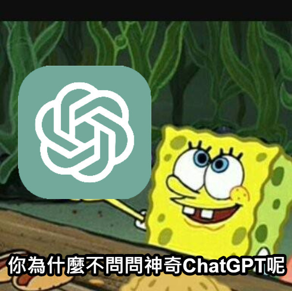
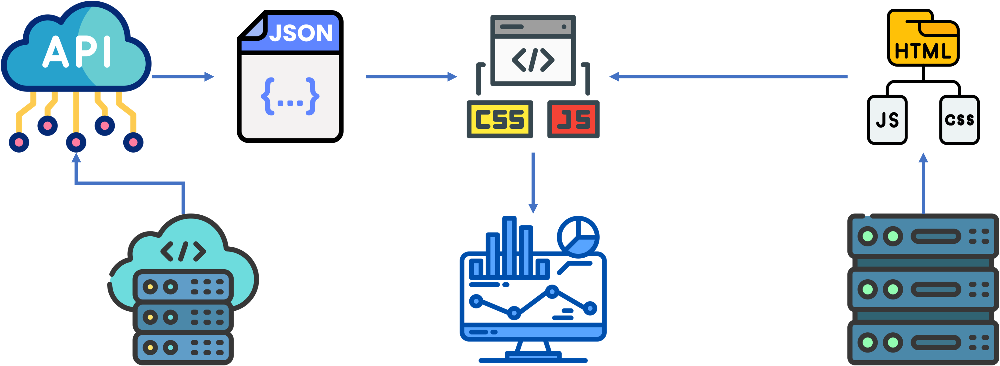

<!-- _class: cover -->

# 人工智慧應用開發實務
## Single Page Application

<hr>

許智超
<cchsu@mail.nsysu.edu.tw>


---

<!-- _class: section-page -->

<span class="num">01</span>

## Agentic Coding Systems

<hr>

---

<!-- _class: stats -->

### 什麼是 Agentic Coding？

<hr>

<div class="stat-wrap">
<div class="stat">

#### AI 是執行者，不只是顧問
<hr>

AI 代理 (Agent) 能自行讀寫檔案、執行指令、安裝套件並測試程式。

</div>
<div class="stat hi">

#### 目標導向的迴圈
<hr>

你給定目標，Agent 自行「規劃 → 實作 → 執行 → 檢查錯誤 → 修正」，直到完成。

</div>
<div class="stat">

#### 人負責方向與驗收
<hr>

人類專注於需求、決策與審查結果，不再逐行手寫程式。

</div>
</div>

---

<!-- _class: cols -->

### 從 Chatbot 到 Agentic Coding

<hr>

<div class="col-wrap">
<div class="col">

#### Chatbot 輔助

- **流程**：提問 → 取得程式碼片段 → 人工複製貼上 → 自行執行。
- **上下文**：只看得到你貼上的內容，不了解整個專案。
- **錯誤處理**：執行失敗後，需把錯誤訊息貼回對話。
- **角色**：AI 是顧問，人是唯一的執行者。

</div>
<div class="col alt">

#### Agentic Coding

- **流程**：描述目標 → Agent 直接修改專案並執行驗證。
- **上下文**：可瀏覽整個專案、讀取檔案與設定。
- **錯誤處理**：自行讀取錯誤訊息並反覆修正。
- **角色**：AI 是執行者，人是決策者與審查者。

</div>
</div>

---

### 為什麼要改用 Agentic Coding？

<hr>

- **省去搬運**：不用在對話視窗與編輯器間來回複製貼上
- **完整上下文**：理解專案結構，產出的程式碼能與既有程式一致
- **自動驗證**：執行、測試、除錯形成閉環，不只給出「看起來對」的程式
- **跨工具操作**：可呼叫 CLI（git、firebase）完成部署，不只是寫程式
- **適合 SPA 開發**：前端、資料庫、驗證、部署多個環節，Agent 可一次串起

> 注意：Agent 也會出錯，需要版本控制 (git) 與人工審查把關。

---

### Agentic Coding 系統的組成

<hr>

- **LLM（大型語言模型）**：負責理解與推理
- **CLI / 工具**：讓模型能讀寫檔案、執行指令（如 Claude Code）
- **MCP**：以標準協定連接外部服務與資料
- **Skill**：封裝可重複使用的做法與指引，讓 Agent 依流程工作

---

<!-- _class: stats -->

### CLI、MCP、Skill 三者的角色

<hr>

<div class="stat-wrap">
<div class="stat">

#### CLI：雙手
<hr>

命令列工具，讓 Agent 能執行 git、npm、firebase 等指令。

</div>
<div class="stat hi">

#### MCP：連接外部
<hr>

標準協定，讓 Agent 存取資料庫、文件、設計工具等外部服務。

</div>
<div class="stat">

#### Skill：工作手冊
<hr>

可重複使用的指引，讓 Agent 依既定流程與慣例完成任務。

</div>
</div>

---

### 介紹 CLI (Command Line Interface)

<hr>

- **定義**：以文字指令操作軟體的介面，不需圖形畫面
- **為何適合 Agent**：輸入輸出皆為文字，Agent 能直接執行並讀取結果
- **兩種角色**：
  - **Agentic Coding CLI**：Agent 本身，如 Claude Code、Gemini CLI、Codex CLI
  - **開發工具 CLI**：Agent 呼叫的工具，如 `git`、`node`、`firebase`
- **範例**：

```bash
git commit -m "Add login page"
firebase deploy --only hosting
```

---

### 介紹 MCP (Model Context Protocol)

<hr>

- **定義**：連接 AI 與外部工具、資料的開放標準協定
- **類比**：如同 AI 的「USB 接口」，一次規格，到處可接
- **運作方式**：MCP Server 提供工具與資料，Agent 作為 Client 呼叫
- **應用範例**：
  - 查詢 Firebase 專案與 Firestore 資料
  - 讀取 Figma、Google Stitch 的設計稿
  - 存取 Google Drive、GitHub、資料庫
- **注意**：MCP 會授權 Agent 操作外部資料，需確認權限範圍

---

### 介紹 Skill

<hr>

- **定義**：以 Markdown 撰寫的指引（`SKILL.md`），封裝特定任務的做法
- **運作方式**：Agent 依任務需求，才載入對應的 Skill，節省上下文
- **內容**：任務說明、步驟、慣例，可附帶範本與腳本
- **優點**：
  - 可重複使用、可分享給團隊
  - 讓 Agent 的產出風格穩定一致
- **範例**：後面會介紹的 `grill-me`，在動手寫程式前先追問釐清需求

---

### CLI、MCP、Skill 比較

<hr>

| | CLI | MCP | Skill |
|---|---|---|---|
| **提供什麼** | 可執行的指令 | 外部服務的連線與工具 | 做事的流程與知識 |
| **形式** | 命令列程式 | 標準協定的 Server | Markdown 檔案 |
| **解決問題** | Agent 能「做」 | Agent 能「連接」 | Agent 知道「怎麼做」 |
| **範例** | `git`、`firebase` | Firebase、Figma MCP | `grill-me` |

---

### Coding Agent

<hr>

| Coding Tool | Claude Code | Codex | Antigravity |
|---|---|---|---|
| **開發者** | Anthropic | OpenAI | Google |
| **模型** | Claude 系列 | GPT 系列 | Gemini 為主 |
| **下載** | [claude.com](https://code.claude.com/docs/zh-TW/desktop-quickstart) | [codex](https://openai.com/zh-Hant/codex/) | [antigravity](https://antigravity.google/download/) |

---

<!-- _class: section-page -->

<span class="num">02</span>

## OpenCode

<hr>

---

<!-- _class: stats -->

### 什麼是 OpenCode？

<hr>

<div class="stat-wrap">
<div class="stat">

#### 開源的終端機 Agent
<hr>

在命令列中運行的 AI 程式開發代理，開放原始碼、可自由使用。

</div>
<div class="stat hi">

#### 不綁定單一模型
<hr>

可連接多家模型供應商（如 Anthropic、OpenAI、Google），也能使用本地模型。

</div>
<div class="stat">

#### 支援 MCP 與 Skill
<hr>

可擴充外部工具，並以設定檔管理專案規則。

</div>
</div>

---

### OpenCode 的特色

<hr>

- **終端機介面 (TUI)**：直接在專案資料夾中對話，Agent 可讀寫檔案、執行指令
- **Plan / Build 模式**：Plan 只分析規劃、不改檔案；Build 才實際修改程式
- **模型自由切換**：同一個工具，依成本與需求更換模型
- **專案規則檔**：`AGENTS.md` 記錄專案慣例，Agent 每次啟動都會參考
- **與 Claude Code 定位相近**：同屬 Agentic Coding CLI，操作概念可互通

---

### OpenCode 安裝與基本使用

<hr>

[Open Code](https://opencode.ai/) 下載 Desktop 版

- `/connect`：連接模型供應商並登入／設定金鑰
- `/models`：選擇要使用的模型
- `/init`：分析專案並產生 `AGENTS.md`
- `Tab`：在 Plan 與 Build 模式間切換

---

### 申請免費模型

<hr>

- [OpenCode Console](https://opencode.ai/console)
- [Nvidia Build](https://build.nvidia.com/)
- [OpenRouter](https://openrouter.ai/)

---

<style scoped>
  p { text-align: center; }
</style>

### 我應該用那個模型呢？

<hr>



---

### 使用免費模型的注意事項

<hr>

- **隱私**：免費模型的對話可能被記錄或拿去訓練，別貼個資、密碼與機密程式碼
- **金鑰保管**：API Key 不可寫進程式或 commit 上 GitHub，外洩請立即撤銷重發
- **速率限制**：每分鐘／每日請求數有上限，遇到 `429` 錯誤就稍候或換模型
- **穩定性**：免費模型可能排隊、變慢，甚至隨時下架或改名
- **能力差異**：Agent 需要支援工具呼叫的模型；context 較短，任務要切小
- **勤做 commit**：模型出錯或中斷時，靠 git 回到上一個正常版本

---

### 在 OpenCode 介接語言模型

<hr>

- 設定步驟
- 設定方式：
  - OpenCode Console
  - Nvidia
  - OpenRouter
  - GitHub Copilot
  - 其他（Anthropic, OpenAI, Google）
- 選用模型

---

<!-- _class: stats -->

### 開發環境：git、Node.js、Python

<hr>

<div class="stat-wrap">
<div class="stat">

#### git
<hr>

版本控制工具，記錄每次修改，可隨時回到先前版本。Agent 改壞程式時，靠它還原。

</div>
<div class="stat hi">

#### Node.js
<hr>

讓 JavaScript 能在瀏覽器之外執行，並提供 npm 套件管理。React 專案與許多 CLI 都需要它。

</div>
<div class="stat">

#### Python
<hr>

語法簡潔的通用程式語言，AI 與資料處理的常用工具。部分 Agent 工具與腳本需要它。

</div>
</div>

---

<style scoped>
.col-wrap .col li, .col p { font-size: 0.8em; }
</style>
<!-- _class: cols -->

### Matt Pocock Skills 與 Superpowers：兩套 Skill 的取向

<hr>

<div class="col-wrap">
<div class="col">

#### Matt Pocock Skills

- **定位**：小型、可組合的 Skill 集合，可自行挑選、修改。
- **流程**：grill-me → to-spec → to-tickets → implement (TDD) → code-review。
- **做法**：由你手動輸入指令，一站一站推進，每站都能檢視與調整。
- **解決問題**：Agent 做出的東西和你想要的不一樣（認知落差）。

</div>
<div class="col alt">

#### Superpowers

- **定位**：完整的軟體開發方法論與 Skill 框架。
- **流程**：brainstorming → writing-plans → 子 Agent 實作與互相審查 → TDD → code review。
- **做法**：Skill 自動觸發，先確認設計，之後 Agent 可自主運作較長時間。
- **解決問題**：避免 Agent 一開始就亂寫程式，並自動走完整個開發流程。

</div>
</div>

---

<style scoped>
td, p { font-size: 0.6em; }
</style>

### Matt Pocock Skills 與 Superpowers 比較

<hr>

| | Matt Pocock Skills | Superpowers |
|---|---|---|
| **設計理念** | 小而可組合，挑需要的用 | 完整框架，整套一起用 |
| **觸發方式** | 以手動指令為主（如 `/grill-me`），部分由模型判斷 | 自動觸發 |
| **需求釐清** | `grill-me`：一次一題、附建議答案；`grill-with-docs` 另產出名詞表與 ADR | `brainstorming`：釐清意圖後分段呈現設計請你核准 |
| **規劃拆解** | `to-spec`、`to-tickets`：依使用者功能垂直切片 | `writing-plans`：拆成含檔案路徑與驗證步驟的小任務 |
| **實作與審查** | `implement` (TDD)、`code-review` | SubAgent 實作並互相審查、TDD、`requesting-code-review` |
| **人的角色** | 每一站都親自把關 | 核准設計後，多由 Agent 自主執行 |
| **學習成本** | 低，可從 `grill-me` 單一指令開始 | 較高，需熟悉整套流程 |

<br>

> 兩者都先釐清需求再動工；差別在於前者由你逐站掌控，後者自動化程度高。

---

### grill-me 的運作規則

<hr>

動工前，讓 AI 反過來訪問你，把計畫想清楚。核心規則只有幾條：

- **決策樹**：把計畫視為決策樹，逐一走訪每個分支與邊界情況
- **一次一題**：等你回答後再問下一題
- **能查就不問**：可從程式碼或檔案查到的事，AI 自己查
- **附建議答案**：每題都附 AI 的建議與理由，你以「審查提案」的方式決策
- **先不寫程式**：共識達成前，不做任何修改

用法：在專案資料夾啟動 Agent，輸入 `/grill-me` 並簡述想做的 SPA，逐題回答即可。

---

### grill-me 之後：完整開發流程

<hr>

grill-me 是起點，可再串接 mattpocock/skills 的其他指令：

1. **grill-with-docs**：拷問時同步產出名詞表與架構決策紀錄 (ADR)
2. **to-spec**：把共識寫成規格書
3. **to-tickets**：依「使用者功能」垂直切片拆成可獨立驗收的任務
4. **implement**：以 TDD 實作，先寫測試再寫功能，避免 AI 寫出配合錯誤結果的假測試
5. **code-review**：以平行子代理檢查專案規範與是否忠實實現規格

---

<!-- _class: section-page -->

<span class="num">03</span>

## 認識 Single Page Application

<hr>

---

<!-- _class: stats -->

### 什麼是 Single Page Application (SPA)？

<hr>

<div class="stat-wrap">
<div class="stat">

#### 單一 HTML 頁面
<hr>

只載入一次 HTML、CSS 與 JavaScript，之後不再整頁重新載入。

</div>
<div class="stat hi">

#### 動態更新內容
<hr>

使用者操作時，由 JavaScript 向後端取得資料，只更新畫面需要變動的部分。

</div>
<div class="stat">

#### 接近原生 App 體驗
<hr>

切換頁面流暢、無白畫面閃爍，操作回應快速。

</div>
</div>

---

<!-- _class: cols -->

### 靜態網頁 vs. SPA：不一樣在哪？

<hr>

| | 靜態網頁 (Static Web Page) | SPA |
|---|---|---|
| **內容來源** | 寫死在 HTML 檔案中 | 執行時由 API 動態取得資料 |
| **互動性** | 僅能瀏覽、點連結換頁 | 可登入、新增、修改、刪除資料 |
| **換頁方式** | 每個頁面是獨立 `.html` 檔 | 同一頁內由 JavaScript 切換畫面 |
| **資料更新** | 需手動修改檔案並重新上傳 | 即時從資料庫讀寫，畫面自動更新 |
| **適合情境** | 公司簡介、說明文件、部落格 | 管理系統、訂單、相簿等應用程式 |

> 兩者都可部署在靜態主機（如 Firebase Hosting）；差別在於 SPA 的畫面由 JavaScript 動態產生，並連接後端服務。

---

<!-- _class: cols -->

### 傳統多頁式網站 vs. SPA

<hr>

<div class="col-wrap">
<div class="col">

#### 多頁式 (MPA)

- **換頁方式**：每次點擊連結，瀏覽器向伺服器請求並載入完整新頁面。
- **畫面渲染**：由伺服器產生 HTML（如 PHP、JSP）。
- **特色**：SEO 容易、架構單純，但換頁有等待與閃爍。

</div>
<div class="col alt">

#### 單頁式 (SPA)

- **換頁方式**：由前端路由切換畫面，網址改變但頁面不重新載入。
- **畫面渲染**：瀏覽器端以 JavaScript 產生畫面，透過 API 交換 JSON 資料。
- **特色**：體驗流暢、前後端分離，但首次載入較重、SEO 需額外處理。

</div>
</div>

---

### SPA 的運作流程

<hr>

1. 瀏覽器第一次請求，伺服器回傳 `index.html` 與 JavaScript 程式包
2. JavaScript 啟動，由**前端路由 (Router)** 決定顯示哪個畫面
3. 需要資料時，以 `fetch` 呼叫 API，取得 **JSON**
4. 依資料更新 DOM，**不重新載入整頁**
5. 使用者切換功能，只重複步驟 2–4

---

<!-- _class: cols -->

### SPA 的優缺點

<hr>

<div class="col-wrap">
<div class="col">

#### 優點

- 操作流暢，使用者體驗佳
- 前後端分離，分工與維護容易
- 同一套 API 可供網頁、手機 App 共用
- 可搭配 PWA 打包成 App、支援離線

</div>
<div class="col alt">

#### 缺點

- 首次載入需下載較多 JavaScript
- 搜尋引擎最佳化 (SEO) 較困難
- 需處理瀏覽器上一頁、網址路由與狀態管理
- 禁用 JavaScript 時無法運作

</div>
</div>

---

### SPA 可以介接資料庫嗎？

<hr>



---

### 常見 SPA 應用與技術

<hr>

- **應用案例**：Gmail、Google Maps、Trello、Notion、Figma
- **前端框架**：React、Vue、Angular、Svelte
- **本課程做法**：以 Firebase（Firestore、Auth、Hosting）作為後端，搭配 AI 輔助開發 (Agentic Coding) 完成 SPA
- **延伸**：將 SPA 封裝為 PWA，安裝到手機如同原生 App

---

<!-- _class: stats -->

### 什麼是 React？

<hr>

<div class="stat-wrap">
<div class="stat">

#### 建構使用者介面的函式庫
<hr>

由 Meta 開發的開源 JavaScript 函式庫，是最普及的前端技術之一。

</div>
<div class="stat hi">

#### 元件化
<hr>

把畫面拆成可重複使用的小零件，如按鈕、卡片、表單，再組合成完整頁面。

</div>
<div class="stat">

#### 資料驅動畫面
<hr>

資料（State）改變時，React 自動更新對應的畫面，不必手動操作 DOM。

</div>
</div>

---

### React 如何實現 SPA？

<hr>

- **元件**：以函式描述一塊畫面，可重複使用與組合
- **JSX**：在 JavaScript 中以類似 HTML 的語法描述畫面
- **State**：元件內的資料，改變後畫面自動重新繪製
- **Router**：如 React Router，依網址切換元件，達成「換頁但不重載」
- **生態系**：搭配 Vite 建置專案，並可直接串接 Firebase

---

<style scoped>
pre, code { font-size: 0.7em; }
</style>

### React 程式碼範例

<hr>

```jsx
import { useState } from 'react'

function Counter() {
  const [count, setCount] = useState(0)

  return (
    <button onClick={() => setCount(count + 1)}>
      點擊次數：{count}
    </button>
  )
}
```

- `useState`：宣告 State，`setCount` 更新後畫面自動變化
- 沒有 `document.getElementById`，直接描述「畫面應該長什麼樣子」

---

### 為什麼選擇 React 開發 SPA？

<hr>

- **AI 熟悉度高**：資料與範例豐富，Agent 產生的 React 程式碼品質穩定
- **生態系完整**：UI 套件、路由、狀態管理皆有成熟選擇
- **與 Firebase 整合容易**：官方 SDK 與社群範例多
- **可延伸至行動端**：React Native、PWA 皆能沿用觀念
- **求職與社群資源多**：學習資源與職缺需求都高

---

<!-- _class: section-page -->

<span class="num">04</span>

## Firebase

<hr>

---

### 什麼是 Firebase？

<hr>

- **定義**：Google 提供的 BaaS (Backend as a Service)，不必自建伺服器
- **為何適合 SPA**：前端直接呼叫 SDK，即可使用資料庫、登入與部署
- **本課程使用三項服務**：
  - **Firestore**：儲存資料
  - **Authentication**：使用者登入
  - **Hosting**：發布網站
- **搭配 React**：官方 Web SDK 以 JavaScript 呼叫，Agent 熟悉度高

---

<!-- _class: stats -->

### Firebase 三項服務的角色

<hr>

<div class="stat-wrap">
<div class="stat">

#### Firestore：資料
<hr>

NoSQL 文件資料庫，資料即時同步到各個畫面。

</div>
<div class="stat hi">

#### Auth：身分
<hr>

提供 Email、Google 等登入方式，辨識「誰在使用」。

</div>
<div class="stat">

#### Hosting：上線
<hr>

將建置好的 SPA 發布到公開網址，並自動提供 HTTPS。

</div>
</div>

---

### Firestore：文件資料庫

<hr>

- **結構**：Collection（集合）→ Document（文件）→ Field（欄位）
- **不需預先定義表格**：欄位可彈性增減
- **即時同步**：資料變動時，畫面自動更新
- **安全規則 (Security Rules)**：定義誰能讀寫哪些資料
- **範例**：`todos` 集合中，每筆待辦事項是一份文件

```js
await addDoc(collection(db, 'todos'), { title: '買牛奶', done: false })
```

---

### Authentication：使用者登入

<hr>

- **功能**：處理註冊、登入、登出，不需自行儲存密碼
- **常見登入方式**：Email／密碼、Google 帳號
- **登入狀態**：SDK 提供使用者資訊，React 依此切換畫面
- **搭配 Firestore**：規則可限制「只能讀寫自己的資料」
- **注意**：登入方式需先在 Firebase Console 啟用

```js
await signInWithPopup(auth, new GoogleAuthProvider())
```

---

### Hosting：發布 SPA

<hr>

- **適合靜態資源**：發布 React 建置後的 HTML、JS、CSS
- **內建 HTTPS 與 CDN**：上線即安全、速度快
- **SPA 重寫規則**：所有網址都導向 `index.html`，讓前端 Router 接手
- **一行指令部署**：

```bash
npm run build
firebase deploy --only hosting
```

---

### 安裝 Firebase CLI

<hr>

- **Firebase CLI**：以指令操作 Firebase 專案的工具，也是 Agent 的「雙手」
- **前置需求**：已安裝 Node.js

```bash
# 安裝
npm install -g firebase-tools

# 確認版本
firebase --version

# 登入 Google 帳號（會開啟瀏覽器授權）
firebase login
```

---

### 常用 Firebase CLI 指令

<hr>

| 指令 | 用途 |
|---|---|
| `firebase projects:list` | 列出可用的專案 |
| `firebase init` | 在專案資料夾設定 Hosting、Firestore 等 |
| `firebase emulators:start` | 在本機模擬服務，先測試再上線 |
| `firebase deploy --only hosting` | 部署網站 |
| `firebase deploy --only firestore:rules` | 部署 Firestore 安全規則 |

---

### 讓 Coding Agent 自動操控 Firebase

<hr>

- **做法**：登入後，在專案資料夾啟動 Agent，用自然語言下達任務
- **Agent 會做的事**：執行 `firebase init`、修改設定檔與規則、建置並部署
- **提示詞範例**：

> 這是用 Vite 建立的 React SPA。請用 Firebase CLI 設定 Hosting（SPA 模式）與 Firestore，撰寫「只能讀寫自己資料」的安全規則，建置後部署，並回報網址。

- **可再加上**：Firebase MCP，讓 Agent 直接查詢專案與資料

---

### 人工把關與注意事項

<hr>

- **登入由你完成**：`firebase login` 需在瀏覽器授權，Agent 不應代為處理帳密
- **部分設定需在 Console**：如啟用登入方式、綁定計費帳戶
- **審查安全規則**：避免 Agent 寫成「任何人都可讀寫」
- **部署前先確認**：要求 Agent 說明將執行的指令與影響範圍
- **勿提交金鑰**：`.env` 等機密檔加入 `.gitignore`

---

### 專案開發環境與規則初始化

<hr>

建立專案規則與工作說明書 `AGENTS.md`
```markdown
請在專案資料夾建立 `AGENTS.md`，內容如下：

## 規則
- 一律使用繁體中文進行對話與撰寫註解。
- 修改程式碼前，先簡要說明修改計畫。
- 環境變數及 API Keys 必須放 .env.local，嚴禁硬編碼在程式碼裡

## 技術棧
- 前端：React + Vite + TypeScript + Tailwind
- 驗證與資料庫：Firebase Auth + Cloud Firestore
- 部署：Firebase Hosting
```

---

### SPA01 Grill Me Spec

<hr>

- 和 AI 討論適合用來做為 SPA + React.js + Firebase Auth + Firestore + Hosting 的專案主題。
- 用 grill-me 及 to-spec 技能產出 Spec。

---

### SPA02 SPA Project

<hr>

- 延續 grill me 的 spec，to-tickets 和 implement 完成專案。

---

<!-- _class: section-page -->

<span class="num">05</span>

## PWA 漸進式網頁應用程式

<hr>

---

### 什麼是 PWA？

<hr>

- **全名**：Progressive Web App，漸進式網頁應用程式
- **定義**：用網頁技術開發，卻能像原生 App 一樣安裝與使用
- **漸進式**：瀏覽器支援多少功能就提供多少，不支援時仍是正常網頁
- **與 SPA 的關係**：SPA 負責頁面體驗，PWA 再補上「安裝」與「離線」能力
- **一套程式碼**：同時應用於電腦與手機，不必分別開發 iOS、Android

---

### 一般網頁 vs. PWA vs. 原生 App

<hr>

| | 一般網頁 | PWA | 原生 App |
|---|---|---|---|
| **安裝方式** | 不需安裝 | 瀏覽器加入主畫面 | 應用程式商店 |
| **離線使用** | 通常不行 | 可（需 Service Worker） | 可 |
| **開發成本** | 低 | 低，一套程式碼 | 高，需分平台開發 |
| **更新** | 重新整理即更新 | 自動更新 | 需使用者更新 |
| **硬體功能** | 有限 | 有限，視瀏覽器而定 | 完整 |

---

<style scoped>
td, th { font-size: 0.6em; }
p { font-size: 0.7em; }
</style>

### 製作 App 的技術比較

<hr>

| | 原生開發 | 跨平台框架 | 混合式封裝 | PWA |
|---|---|---|---|---|
| **代表技術** | Swift (iOS)、Kotlin (Android) | React Native、Flutter | Capacitor、Cordova | Vite + React + Service Worker |
| **程式語言** | 各平台各自語言 | JavaScript／Dart | HTML、CSS、JavaScript | HTML、CSS、JavaScript |
| **程式碼共用** | 低，需維護兩套 | 高 | 高，沿用網頁程式 | 最高，一套網頁 |
| **效能與體驗** | 最佳 | 接近原生 | 取決於 WebView | 取決於瀏覽器 |
| **硬體功能** | 完整 | 大部分 | 透過外掛 | 有限 |
| **上架與發布** | 應用程式商店 | 應用程式商店 | 應用程式商店 | 網址即可，免審核 |
| **適合情境** | 重度效能、深度整合系統功能 | 需商店上架的新 App | 已有網頁，想包成 App | 快速上線、內部工具 |

<br>

> 課程的 SPA 已是網頁，加上 PWA 成本最低；需要上架商店時，再考慮用 Capacitor 封裝。

---

<!-- _class: stats -->

### PWA 的三項核心條件

<hr>

<div class="stat-wrap">
<div class="stat">

#### HTTPS
安全
<hr>

網站須以 HTTPS 提供，Firebase Hosting 預設即支援。

</div>
<div class="stat hi">

#### Manifest
身分
<hr>

描述 App 名稱、圖示、顏色，讓瀏覽器知道如何安裝。

</div>
<div class="stat">

#### Service Worker
離線
<hr>

在背景運作的腳本，負責快取資源與離線使用。

</div>
</div>

---

<style scoped>
pre, code { font-size: 0.8em; }
</style>

### Web App Manifest

<hr>

- **形式**：一個 JSON 檔（如 `manifest.webmanifest`），在 HTML 中引用
- **內容**：名稱、圖示、啟動網址、顯示模式、主題色
- **效果**：使用者可「加入主畫面」，以獨立視窗開啟，沒有網址列

```json
{
  "name": "待辦事項",
  "short_name": "Todo",
  "start_url": "/",
  "display": "standalone",
  "theme_color": "#1a73e8",
  "icons": [{ "src": "/icon-512.png", "sizes": "512x512", "type": "image/png" }]
}
```

---

### Service Worker

<hr>

- **定義**：瀏覽器在背景執行的 JavaScript，位於網頁與網路之間
- **主要用途**：
  - **快取資源**：離線時仍能開啟 App 的外殼
  - **加快載入**：重複造訪時直接讀取快取
  - **進階功能**：推播通知、背景同步
- **注意**：更新策略需設計好，否則使用者可能看到舊版畫面
- **實務做法**：多半交給工具產生，不自行手寫


---

### 用 Vite 與 Agent 將 SPA 變成 PWA

<hr>

- **做法**：在 Vite 專案加入 `vite-plugin-pwa`，自動產生 manifest 與 Service Worker
- **提示詞範例**：

> 請為這個 Vite + React 專案加入 PWA 支援：使用 vite-plugin-pwa，設定 manifest 與圖示，讓 App 可離線開啟外殼，最後建置並部署到 Firebase Hosting。

- **驗證**：以 Chrome 開發者工具的 Application 面板檢查 Manifest 與 Service Worker
- **安裝**：網址列會出現安裝圖示，手機則選「加入主畫面」
- **提醒**：iOS 的 PWA 功能（如推播）受限較多，需實機測試

---

<!-- _class: section-page -->

<span class="num">06</span>

## 3D RPG SPA Game

<hr>

---


### 目標：3D RPG 網頁遊戲

<hr>

- **題材**：用 Three.js 製作的小型 3D RPG，玩家探索場景、與 NPC 對話、完成任務、抵達結局
- **技術**：
  - React SPA（畫面與狀態）
  - Firebase（登入與存檔）
  - PWA（安裝與離線）
- **任務**：決定故事與玩法、確認設計、試玩驗收；程式由 Agent 實作
- **成果**：一個公開網址，別人能用電腦或手機開啟、安裝並玩到結局

---

<style scoped>
td, th { font-size: 0.8em; }
</style>

### 技術棧

<hr>

| 工具 | 用途 |
|---|---|
| **Vite + React + TypeScript** | SPA 外殼：選單、對話框、HUD |
| **Three.js + React Three Fiber** | 在 React 中以元件描述 3D 場景 |
| **drei** | 相機、載入 glTF 模型等現成工具 |
| **zustand** | 任務、道具、對話等遊戲狀態 |
| **Vitest + Playwright** | 邏輯單元測試、瀏覽器流程測試 |
| **Firebase Auth / Firestore** | 登入與雲端存檔（選用） |
| **vite-plugin-pwa** | Manifest 與 Service Worker |
| **Firebase Hosting** | 部署，提供 HTTPS |

---

<style scoped>
td, th { font-size: 0.65em; }
</style>

### 六階段開發流程

<hr>

| 階段 | 你與 Agent 做什麼 | 成果 | 搭配的 Skill |
|---|---|---|---|
| **1 世界觀與故事** | 決定主題、角色、故事與範圍 | `01_世界觀與故事.md` | grill-me |
| **2 關卡與互動** | 設計任務、操作、狀態與防卡關 | `02_關卡與互動規格.md` | grill-me |
| **3 場景與 UI** | 規劃地圖、鏡頭、提示與畫面 | `03_場景與UI規格.md` | grill-me |
| **4 實作** | 確認技術、先做一條可玩流程再擴充 | 可從頭玩到尾的遊戲 | grill-with-docs、to-tickets、implement |
| **5 測試與修正** | 自動測試、試玩、修正 | 主要流程通過測試 | tdd、diagnosing-bugs、code-review |
| **6 部署與驗證** | 建置、PWA、部署、網址驗證 | 公開網址 | — |

---

### 為什麼先規格、後程式？

<hr>

- **Agent 很會寫程式，但不知道你想要什麼**：沒講清楚，就會自行猜測
- **規格是共同語言**：你與 Agent 都對照同一份文件，避免「做出來不是我要的」
- **編號貫穿三份文件**：PLAYER01、NPC01、Q01、ITEM01，之後程式與測試也使用
- **規格會變成測試**：階段二的驗收條件，在階段五直接轉成自動化測試
- **你的責任**：確認設計、說明選擇理由；**Agent 的責任**：釐清、檢查一致性、整理文件

---

### 階段一 世界觀與故事：你要決定什麼？

<hr>

回答四個問題：**玩家是誰？為什麼冒險？會經歷什麼？如何結束？**

- **產出**：`01_世界觀與故事.md`
- **文件內容**：
  - 專題基本資料（名稱、目標玩家、遊玩時間、期限、平台）
  - 核心概念（一句話介紹、玩家目標、體驗）
  - **製作範圍**：必做、可選、本次不做
  - 世界觀、角色（PLAYER01、NPC01…）、故事流程、關鍵文字
  - 設計決策紀錄（至少兩項採用、修改或拒絕 AI 建議的理由）
  - 待確認問題
- **驗收**：其他人讀完，能說出故事、目標與製作範圍

---

### 與 Agent 討論的方式

<hr>

使用 `/grill-me`，並加上規則：

```text
- 有先後依賴的問題等前一題決定後再問
- 每題附選項、建議與理由，由我做最後決定
- 重要決策說明理由，不要只回答「是」
- 聽不懂就說：「我不知道，請先解釋或舉例」
- 範圍要小：不確定能不能做的內容，放進「可選」或「不做」
- 結束：Agent 摘要已確認決策與剩餘問題，你確認後才產生 .md 檔
```

---

<style scoped>
pre, code { font-size: 0.8em; }
</style>

### 階段一 世界觀與故事：提示詞

<hr>

```text
你是我的 3D RPG 遊戲企畫協作 agent，現在進行第一階段「世界觀與故事設計」。
本階段只討論與整理設計，不撰寫程式、不建立原型。

【我的專題條件】
- 初步遊戲構想：
- 目標玩家：
- 預計遊玩時間：
- 執行平台：React + Three.js 的 SPA，部署在 Firebase Hosting，做成 PWA，【填寫裝置】

【討論方式】每次最多問三個問題；提出兩個故事方向比較難度與素材需求，由我選擇；構想超出範圍時提出縮減方案；不確定的內容標示「待確認」。

【產出】角色使用固定編號；討論後經我確認，建立「01_世界觀與故事.md」。
```

---

<style scoped>
p, li { font-size: 0.8em; }
</style>

### 階段二 關卡與互動機制：你要決定什麼？

<hr>

把故事轉成玩家能操作的任務：**什麼情況可以做、怎麼做、做了會怎樣、怎樣算完成。**

- **輸入**：`01_世界觀與故事.md`
- **產出**：`02_關卡與互動規格.md`
- **文件內容**：
  - 核心遊玩循環（探索 → 對話 → 蒐集 → 交付）、操作方式
  - 任務總表（Q01、Q02…）與前置、解鎖關係
  - 每個任務：觸發、行動、成功條件、錯誤回饋、防卡關
  - 互動物件（ITEM01…）、狀態規則、重新開始規則
  - 驗收條件、紙上試玩紀錄
- **驗收**：每個任務都有觸發、操作、結果與驗收方式，流程能走到結局

---

<style scoped>
pre, code { font-size: 0.7em; }
</style>

### 階段二 關卡與互動機制：提示詞

<hr>

```text
請使用 /grill-me 協助我，配合討論規則：每輪最多三題、附建議、為我說明重要決策的理由、範圍不擴大。

你是我的 3D RPG 關卡與互動設計協作 agent，現在進行第二階段。
本階段只設計規則與整理文件，不撰寫程式。

請閱讀「01_世界觀與故事.md」，先摘要你的理解；
沿用既有編號與名稱，需修改第一階段時先說明原因。

請設計：核心遊玩循環、操作方式、任務總表與解鎖關係、每個任務的詳細規格（含錯誤回饋與防卡關）、物件互動規則、任務與道具狀態、重新開始規則，以及每個任務的驗收條件（在什麼前提下 → 玩家做什麼 → 應出現什麼結果）。

之後和我進行紙上試玩。確認後建立「02_關卡與互動規格.md」，
任務用 Q01、物件用 ITEM01 編號。
```

---

<style scoped>
p, th, td, li { font-size: 0.7em; }
</style>

### 階段二 關卡與互動機制：紙上試玩

<hr>

Agent 描述情境，**你選擇玩家行動**，再依規則檢查結果。至少試六種情況：

| 情況 | 要問的問題 |
|---|---|
| 正常完成 | 能從開始走到結局嗎？ |
| 沒接任務就操作物件 | 畫面給什麼回饋？ |
| 沒道具就交付 | 玩家知道缺什麼嗎？ |
| 重複拾取、對話、領獎 | 道具會變兩個嗎？ |
| 任務順序錯誤 | 會不會卡關？ |
| 結束後重新開始 | 狀態有清乾淨嗎？ |

<br>

- 發現的問題與修改，記錄在文件中
- **這些條件就是階段五的測試案例**

---

<style scoped>
p, li { font-size: 0.8em; }
</style>

### 階段三 3D 場景與遊戲 UI：你要決定什麼？

<hr>

回答：**玩家在哪裡、往哪走、看見什麼、畫面如何提示操作。**

- **注意**：這裡是「規劃」3D 場景，不是建立；用文字、俯視示意圖與 UI 草圖表達
- **輸入**：前兩份文件；**產出**：`03_場景與UI規格.md`
- **文件內容**：
  - 視覺風格、地圖配置、尺度（以公尺為基準）
  - 鏡頭與移動規則、碰撞、互動距離與提示
  - UI 畫面：開始、遊玩、對話、結束
  - 素材清單（模型、圖像、音效、音樂）
  - 驗收條件
- **驗收**：每個任務需要的角色、物件、提示都有對應位置

---

<style scoped>
pre, code { font-size: 0.8em; }
</style>

### 階段三 3D 場景與遊戲 UI：提示詞

<hr>

```text
請使用 grill-me 協助我，配合討論規則（每輪最多三題、附建議、我說明理由）。

你是我的 3D RPG 場景與 UI 設計協作 agent，現在進行第三階段。只完成設計文件與示意圖，不寫程式、不建立原型、不製作正式模型。

請閱讀「01_世界觀與故事.md」「02_關卡與互動規格.md」，先整理任務需要的區域、NPC、物件與畫面，找出缺漏或矛盾。

請設計：視覺風格、地圖俯視示意與圖例、尺度、鏡頭、移動與碰撞、互動距離與多物件選擇規則、UI 各畫面（出現條件、元素、按鈕、是否暫停移動、手機與電腦配置）、素材清單（未取得標示「待取得」）。
區分「已確認」與「待測試調整」的數值。

確認後建立「03_場景與UI規格.md」，最後交叉檢查三份文件的一致性。
```

---

<style scoped>
p, li, th, td { font-size: 0.7em; }
</style>

### 階段三：場景規格怎麼寫

<hr>

寫成**可檢查的規則**，而不是只畫圖：

| 主題 | 寫法範例 |
|---|---|
| **尺度** | 玩家身高 1.7 m；道路寬 4 m；NPC01 距出生點約 20 m |
| **互動** | 距離 2 m 內顯示「按 E 對話」；多個物件取最近者 |
| **鏡頭** | 第三人稱，距離 8 m，跟隨玩家，不穿牆 |
| **UI** | 對話開啟時，角色停止移動；按 Esc 關閉 |
| **手機** | 左下搖桿、右下互動按鈕；文字不小於 16 px |
| **素材** | `MODEL01` 玩家：先用膠囊體，狀態「待取得」 |

<br>

- 不只靠顏色傳達資訊：配合圖示或文字
- 地圖用 Markdown 文字圖或 Mermaid；獨立圖片放 `assets/design/`

---

### SPA03 3D RPG Game 設計規格

<hr>

- 以 grill-me 完成階段一至三，產出三份 Markdown 規格
- 規格寫明：範圍、任務與驗收條件、地圖、鏡頭、UI 與素材清單
- 交付前請 Agent 交叉檢查三份文件的名稱、編號與規則是否一致

---

### 階段四 技術規劃與實作：先做一條可玩流程

<hr>

- **先確認再動工**：Agent 讀三份規格，列出缺漏，每輪最多三題
- **grill-with-docs**：釐清技術決策，同步留下名詞表與決策紀錄
- **to-tickets**：依使用者功能垂直切片拆工作，保留在本地專案
- **implement**：逐項實作
- **第一條切片**：開始遊戲 → 移動 → NPC 互動 → 第一個任務 → 顯示結果
- **之後再擴充**：其他任務、結局、正式模型、UI、音效與背景音樂
- **初期用暫代素材**：方塊、膠囊體即可，不把未取得的素材說成完成

---

<style scoped>
pre, code { font-size: 0.66em; }
</style>

### 階段四 技術規劃與實作：提示詞

<hr>

```text
現在開始第四階段：技術規劃與遊戲實作。請閱讀 01、02、03 三份規格。
本階段直接在專案中實作，不需要產出階段報告。

1. 找出規格缺漏與矛盾，每輪最多問三個必要問題。
2. 用我能理解的方式說明建議技術棧：用途、理由、目前是否可用。
   使用 React + Three.js (React Three Fiber)，不為了用更多工具而增加複雜度。
3. 依需要使用 grill-with-docs、to-tickets、implement；
   任務保留在本地專案，不建立遠端議題。
4. 我確認技術選擇後開始實作，先完成：
   開始遊戲 → 移動 → NPC 互動 → 第一個任務 → 顯示結果。
5. 之後逐步加入其他任務、結局、模型、UI、音效；初期用暫代素材。
6. 需要 Blender、音訊生成或外部素材時，先確認能力與授權，
   不得把尚未取得的素材說成已完成。
7. 每完成一段可玩功能就啟動預覽，告訴我：能玩什麼、如何檢查、需要我決定什麼。
```

---

### 階段四 技術規劃與實作：你如何驗收與回報

<hr>

預覽時親自操作，並用**具體描述**回報：

| 不好的說法 | 好的說法 |
|---|---|
| 不好玩 | 走到 NPC01 前 1 m 才出現提示，希望 2 m 就出現 |
| 有 bug | 領完獎勵再對話一次，又拿到一把鑰匙 |
| 看不到東西 | 手機橫向時對話框蓋住按鈕 |

- 回報格式：**操作步驟 → 預期結果 → 實際結果**
- 玩法與規格不符，先請 Agent 說明依據哪一條規格，再決定改規格或改程式

---

### 階段五 測試與修正：測什麼？

<hr>

- **規則測試（tdd）**：任務前置條件、完成條件、道具取得與消耗、重複互動、重複領獎、結局、重新開始
- **瀏覽器自動化**：Playwright 走過主要流程；讓測試能讀取任務與道具狀態，不必判讀畫面
- **介面檢查**：UI、鏡頭、碰撞、音量與靜音、指定螢幕尺寸
- **修錯流程（diagnosing-bugs）**：先重現與定位，再修正並複測
- **品質檢查（code-review）**：程式品質與規格符合情況
- **真人試玩**：自己玩、故意亂操作、請同學試玩並觀察卡住的位置
- **誠實回報**：只有實際執行成功的測試，才能標示為通過

---

<style scoped>
pre, code { font-size: 0.68em; }
</style>

### 階段五 測試與修正：提示詞

<hr>

```text
現在開始第五階段：測試與修正。請依三份規格檢查目前遊戲，
直接執行測試與修正，不需要產出測試報告。
依需要採用 tdd、diagnosing-bugs、code-review。

1. 檢查遊戲能否啟動，模型與音檔是否載入。
2. 測試任務前置與完成條件、道具取得與消耗、重複互動、
   重複領獎、結局及重新開始。
3. 為重要規則建立有意義的自動化測試。
4. 用瀏覽器自動化走過主要遊玩流程。
5. 檢查 UI、鏡頭、碰撞、音量、靜音，以及指定裝置的顯示與操作。
6. 發現問題先重現與定位，再修正並重新測試。
7. 只把實際執行成功的測試標示為通過。

完成一輪後給我簡短的真人試玩清單，並引導我邀請一位同學試玩。
結束時告訴我：通過哪些檢查、已知限制、是否具備部署條件。
```

---

### 階段五 測試與修正：觀察同學試玩

<hr>

- **不要提示**：請同學自己玩，你只觀察
- **記錄**：
  - 在哪個位置停下來、困惑多久
  - 沒注意到的提示或按鈕
  - 做了哪些規格沒想到的操作
- **整理成回報**：操作步驟、預期結果、實際結果，交給 Agent 修正
- **判斷**：同學卡關代表規格或提示有問題，而不是同學不會玩

---

### 階段六 PWA 與部署：遊戲也要變成 PWA

<hr>

- **沿用本單元做法**：`vite-plugin-pwa` 產生 Manifest 與 Service Worker
- **遊戲要注意**：
  - 模型與音檔較大，需確認有被離線快取
  - 手機玩 3D 建議橫向，Manifest 設定顯示方向
  - iOS 需使用者點擊後才播放聲音，所以要有「開始遊戲」按鈕
  - 新版本發布後，提示使用者重新載入
- **驗證**：Chrome 開發者工具開啟離線模式，重新整理後仍能開始遊戲
- **部署**：沿用 Firebase Hosting；不能只看工具顯示成功，要從正式網址再驗證

---

<style scoped>
pre, code { font-size: 0.68em; }
</style>

### 階段六 PWA 與部署：提示詞

<hr>

```text
現在開始第六階段：部署與上線驗證。

請先加入 PWA 支援（vite-plugin-pwa）：設定 manifest 與圖示，
確認模型與音檔可離線使用，並在新版本發布時提示重新載入。

部署平台使用 Firebase Hosting。請先完成所有本地建置與檢查；
需要我登入帳號、確認公開範圍或處理費用時，清楚告訴我步驟。
不要自行購買服務或公開與遊戲無關的檔案。

部署後從正式網址檢查：首頁、模型貼圖音效載入、任務與結局、
重新整理、離線開啟與安裝、手機操作、路徑與大小寫錯誤。
發現問題就修正、重新部署並複測；無法親自驗證的項目，提供我檢查步驟。

最後提供：正式網址、簡短操作說明、已知限制、重新部署的方法。
```

---

### 階段六  PWA 與部署：驗收清單

<hr>

- [ ] 正式網址能開啟首頁
- [ ] 模型、貼圖、音效與背景音樂正常載入
- [ ] 能完成任務、看到結局並重新開始
- [ ] 重新整理頁面後仍正常
- [ ] 離線模式下仍能開啟遊戲
- [ ] 手機能「加入主畫面」並以 App 方式開啟
- [ ] 手機上有聲音、操作順暢
- [ ] 主控台沒有路徑、大小寫或網路錯誤
- [ ] 請同學用自己的裝置開啟網址試玩

---

### SPA04 3D RPG Game 部署與上線驗證

<hr>

- 依階段六部署到 Firebase Hosting，並加入 PWA 離線與安裝
- 提交正式網址，且能在手機以 App 方式開啟並玩到結局
